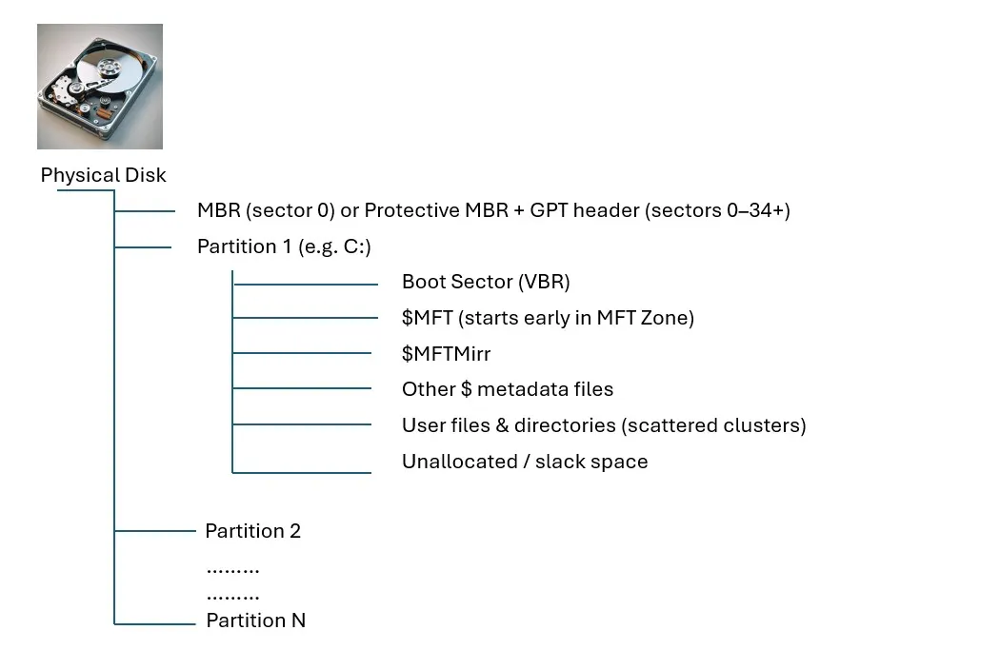

## Proje Nedir?

`wiper`, Windows çalışırken çift tıklanabilen ve sistem yeniden başladığında
hedef diski **otomatik olarak** geri döndürülemeyecek şekilde silen bir araçtır.
Kullanıcıdan herhangi bir ek giriş beklenmez — her şey programın kendisi tarafından yönetilir.

Bu araç, **işletim sisteminin kurulu olduğu diski dahi** canlı olarak silmek üzere tasarlanmıştır.

---

## Neden Böyle Bir Şeye İhtiyaç Var?

Bir bilgisayarın diskini tamamen silmek gerektiğinde,
bu işlem **Windows açıkken yapılamaz:**

- Windows kendi dosyalarını RAM'e yüklemiş halde çalışıyor
- C: sürücüsündeki dosyalar işletim sistemi tarafından kilitli

Çözüm: **sistemi başka bir ortamdan başlatmak** ve ana diski o ortamdan silmek.

---

## Çözüm Alternatifleri

### Linux Live USB

USB'den bir Linux başlatıp `shred` veya `dd` ile disk silinebilir.

**Sorunlar:** Kullanıcı USB hazırlamak zorunda, boot sırasında manuel seçim
yapması gerekir, yazılım tarafından otomatikleştirilemez.

### WinRE (Windows Recovery Environment) — Seçilen Yöntem

WinRE, Windows'un zaten içinde gelen ve sistem bozulduğunda kullanılan küçük bir
kurtarma ortamıdır. Her Windows kurulumunda hazır bulunur; kurulum dosyalarının
üzerine eklenmiş gibi çalışan bir "acil durum" işletim sistemidir.

Teknik olarak WinRE, WinPE tabanlı bir kurtarma ortamıdır. WinRE, gizli bir partition'da `winre.wim` adıyla saklanır. Sistem açılırken "Gelişmiş Başlangıç Seçenekleri" menüsünden seçilirse, Windows bu dosyayı RAM'e yükler ve oradan çalıştırır.

**WinRE neden seçildi:**

| | Linux USB | WinRE |
|---|---|---|
| Kullanıcı hazırlığı | ❌ USB gerekir |✅ Zaten kurulu |
| Secure Boot uyumlu | ❌ | ✅ MS imzalı |
| Yazılımdan tetiklenebilir | ❌ | ✅ `reagentc /boottore` |
| Kullanıcı müdahalesi | ❌ Gerekir | ✅ Gerekmez |

WinRE her makinede hazır, Microsoft tarafından imzalı ve yazılım üzerinden
tetiklenebilir. Bu nedenle tek tıkla çalışan bir araç için en uygun seçenek.

---

## Nasıl Çalışır?

`wiper.exe` Windows'ta yönetici (Administrator) olarak çalışır ve
şu adımları izler:

### Windows'ta (EXE çalışırken)

**[1/5] WinRE'yi bul**
`reagentc /info` komutuyla `winre.wim` dosyasının diskteki tam yolu bulunur.

**[2/5] Disk tipini tespit et**
Windows IOCTL API'si üzerinden hedef diskin HDD mi, SATA SSD mi,
yoksa NVMe SSD mi olduğu anlaşılır. Bu bilgi, uygun silme komutunu seçmek için kullanılır.

**[3/5] WinRE imajını yamala**
`winre.wim` DISM ile geçici bir klasöre açılır (mount edilir). İçine
silme scriptleri gömülür ve WinRE'nin başlangıç ayar dosyası
(`winpeshl.ini`) değiştirilerek açılışta doğrudan bu scriptlerin
çalışması sağlanır. Ardından değişiklikler `winre.wim`'e geri yazılır.

> **Güvenlik notu:** Patch başlamadan önce `winre.wim`'in bir yedeği
> `%TEMP%\winre_wiper_backup_<PID>.wim` konumuna alınır. Geri sayım
> sırasında herhangi bir tuşa basılırsa bu yedek otomatik olarak geri
> yüklenir ve `winre.wim` orijinal haline döner.

**[4/5] Geri sayım**
10 saniye geri sayım başlar. Bu sürede herhangi bir tuşa basılırsa
işlem iptal edilir.

**[5/5] Yeniden başlat**
`reagentc /boottore` ile BCD'ye "bir sonraki açılışta WinRE'ye gir"
bayrağı eklenir. Ardından sistem yeniden başlatılır.

WinRE `winre.wim`'den RAM'e yüklenir. `winpeshl.ini` okunur ve
Wiper tarafından gömülen script dosyası çalıştırılır.

---

## Disk Mimarisi

Wiper'ın arka planda nasıl çalıştığını ve kullanılan silme komutlarının diskin tam olarak neresini hedef aldığını daha iyi kavrayabilmek için, standart bir diskin mimarisini anlamak gerekir:



### 1. Disk Seviyesi (En Üst Kısım)
**MBR / Protective MBR + GPT Header:** Diskin en başında (Sektör 0 ve takip eden ilk sektörler) bölümleme tablosu bilgileri yer alır. Tüm diskin "haritası" buradadır. Bilgisayar diske baktığında önce bu haritayı okur ve içinde kaç tane bölüm (partition) olduğunu anlar.

### 2. Partition 1 (Örnek C: Sürücüsü) Yapısı
NTFS dosya sistemine sahip bir bölümün iç yapısı (örneğin işletim sisteminin kurulu olduğu C: diski) şöyledir:

- **Boot Sector (VBR - Volume Boot Record):** Bölümün en başında yer alır. Bilgisayar açılırken, ana bootloader buraya gelerek o bölüme özel işletim sistemi yükleyicisini çalıştırır.
- **$MFT (Master File Table) & $MFTMirr:** NTFS dosya sisteminin beynidir. Diskteki her dosyanın adı, boyutu, oluşturulma tarihi ve hangi sektörlerde olduğu bilgisi bu tabloda tutulur. `$MFTMirr` ise bunun güvenliğini sağlamak için tutulan yedeğidir (ayna kopyası).
- **Other $ metadata files:** NTFS'e özel olan `$LogFile` (işlem günlüğü), `$Bitmap` (boş/dolu alan haritası), `$BadClust` (bozuk sektör listesi) gibi arka planda çalışan sistem dosyalarını temsil eder.
- **User files & directories:** Kaydedilen fotoğraflar, oyunlar ve belgeler gibi kullanıcı verileridir. Bu veriler diskteki *cluster* (küme) adı verilen alanlara dağınık bir şekilde yazılır. Gerçek veriler bu bölümde yer alır.
- **Unallocated / Slack space:** Bölüm içindeki henüz kullanılmamış boş alanları ve dosya boyutlarının cluster boyutuna tam oturmamasından kaynaklanan küçük boşlukları (slack space) ifade eder.

### 3. Partition 2 ... Partition N
Diskin geri kalanında, tıpkı birinci bölüm gibi kendi içinde bağımsız dosya sistemlerine (VBR, meta veri dosyaları vb.) sahip diğer bölümlerin (örneğin yedek disk olan D: sürücüsünün veya gizli kurtarma bölümlerinin) gelebileceği alanlardır. Her partition kendi içinde yukarıdaki "Partition 1" yapısını tekrar eder.

---

## Projede Kullanılan Silme Komutları

Disk mimarisi incelendikten sonra artık Windows'un varsayılan disk komutlarının nerede çalıştığına ve nerede yetersiz kaldığına bakılabilir:

- **`clean` Komutu (Disk Düzeyinde Çalışır):** Bu komut tamamen "1. Disk Seviyesi"ni hedef alır. Diskin en başındaki MBR/GPT haritasını (partition tablosunu) siler. Diskin haritası yok olduğu için bilgisayar diski "RAW" (ham ve boş) olarak görür. **Ancak:** `clean` komutu alt taraftaki partitionların içine girip oradaki "User files & directories" (gerçek veriler) kısmına ASLA dokunmaz. Yani işletim sistemi diski boş sansa da, basit bir veri kurtarma programı (harita olmadan da) verileri diskte bulabilir. Bu yüzden güvenli silme için tek başına yetersizdir.
- **`clean all` Komutu (Tüm Sektörleri Ezer):** Haritayı silmekle kalmaz, "1. Disk Seviyesi"nden başlar ve son partition'ın en son sektörüne kadar ayrım gözetmeksizin her şeyin (MFT, kullanıcı verileri, işletim sistemi) üzerine sıfır (0) yazar. Veriler fiziksel olarak yok olur.
- **`format` Komutu (Sürücü Düzeyinde Çalışır):** Bu komut diskin geneline değil, sadece belirli bir bölümün (örneğin sadece Partition 1 / C: sürücüsü) içine girer.
  - **`/Q` (Hızlı Format):** Yalnızca o bölümün yönetim dosyalarını (VBR, $MFT) silip baştan oluşturur. Verilerin üzerine sıfır yazmaz, o alanları sadece "boş ve üzerine yazılabilir alan" olarak işaretler.
  - **`/P:1` (Rastgele Format):** Önce MFT'yi yeniler, ardından o partition içindeki tüm cluster'ların üzerine 1 tur sıfır ve 1 tur rastgele veri (random bits) yazar. Fiziksel manyetik izleri bile yok ettiği için saatlerce sürer.
  - *Neden tüm disk formatlanmaz?* Çünkü format komutu partition içindedir; diskin en başındaki MBR/GPT haritasına dokunamaz. Tüm diski formatlamak diye bir şey yoktur, her partition ayrı formatlanmak zorundadır.

---

## Silme Stratejileri

HDDs (Mekanik Diskler) ve SSDs (Katı Hal Sürücüleri) veriyi tamamen farklı depoladığı için, Wiper alt taraftaki donanımı tespit edip ona göre tamamen farklı algoritmalar çalıştırır.

---

**HDD İçin Seçilen Yöntem: `clean all` (NIST 800-88 Standardı)**
1. `diskpart` → Diskpart aracı açılır, `select disk N`, `clean all` komutları ile disk tamamen sıfırlanır; ardından `exit` ile CMD ortamına dönülür.
2. `wpeutil shutdown` → İşletim sistemi kalmadığı için sistem tamamen kapatılır (reboot anlamsızdır).
(Neden eski DoD standartları gibi rastgele veri yazılmadı? Günümüz yüksek yoğunluklu HDD'lerinde tek geçiş sıfır yazmak veriyi donanımsal olarak (mikroskopla bile) kurtarılamaz hale getirdiği için güncel NIST standartlarında yeterli kabul edilir.)

**HDD İçin Alternatif Yöntem: Dinamik Bölümleme ve Rastgele Veri Formatı (`RandomFill`)**
Eğer sıfır yerine mutlaka rastgele veri yazılmak istenirse bu mod kullanılabilir. Mimari şu şekildedir:
1. `diskpart` → Diskpart aracı açılır, `select disk N`, `clean`, `create partition primary`, `assign letter=Z` komutları ile disk RAW hale getirilip geçici bir sürücü harfi (Z:) atanır; ardından `exit` ile CMD ortamına dönülür.
2. `format Z: /FS:NTFS /P:1 /Y`
- **`format Z:`**: `Z:` sürücü harfine bağlı partition'ı biçimlendirir.
- **`/P:1`**: Partition içindeki her hücrenin üzerine sırayla önce sıfır (0), ardından rastgele bitler yazarak veriyi manyetik olarak yok eder.
- **`/Y`**: Format sırasında gelen "devam etmek istiyor musunuz?" onay sorusunu kaldırır. Scriptin otomatik çalışması için gereklidir.
3. `diskpart` → Diskpart tekrar açılır, `select disk N`, `clean` komutuyla geçici partition tablosu silinir ve disk tekrar ham (RAW) bırakılır; ardından `exit` ile çıkılır.
4. `wpeutil shutdown` → Sistem tamamen kapatılır.
Ancak bu mimari `clean all` işlemine göre çok daha fazla zaman alır. Yüksek bir güvenlik standardı hedeflenmediği sürece stabil ve hızlı olan `clean all` (ZeroFill) seçeneği varsayılan olarak önerilir. İstenirse `main.cpp` içerisinden `RandomFill` stratejisi seçilerek bu mod aktif edilebilir.

**SSD İçin Seçilen Yöntem: Partition Oluştur, Hızlı Formatla ve Temizle.**
SSD'lerde `clean all` (sıfır yazmak) veya `format /P:1` (rastgele veri yazmak) iki büyük soruna yol açar:
- **Ömür Tüketimi (TBW):** Terabaytlarca veriyi boş yere yazmak SSD bellek hücrelerinin ömrünü ciddi şekilde tüketir.
- **Güvenlik İllüzyonu (Wear-Leveling):** Tüm sektörlere sıfır yazıldığı düşünülse bile SSD kontrolcüsü bunu diske dağıtır ve eski verinin bir kısmı gizli yedek alanlarda fiziksel olarak kalabilir.

Bu mod, diski yeniden bölümlendirip hızlı format uygular:
1. `diskpart` → Diskpart aracı açılır, `select disk N`, `clean`, `create partition primary`, `assign letter=Z` komutları ile disk RAW hale getirilip geçici bir sürücü harfi (Z:) atanır; ardından `exit` ile CMD ortamına dönülür.
2. `format Z: /FS:NTFS /Q /Y`
- **`format Z:`**: `Z:` sürücü harfine bağlı partition'ı biçimlendirir.
- **`/Q`**: Hızlı format anlamına gelir. Dosya tablosunu yeniden kurar, fakat eski verileri fiziksel olarak doğrudan silmez.
- **`/Y`**: Format sırasında gelen "devam etmek istiyor musunuz?" onay sorusunu kaldırır. Scriptin otomatik çalışması için gereklidir.
3. `diskpart` → Diskpart tekrar açılır, `select disk N`, `clean` komutuyla geçici partition tablosu silinir ve disk tekrar ham (RAW) bırakılır; ardından `exit` ile çıkılır.
4. `wpeutil shutdown` → Sistem tamamen kapatılır.

### Neden `format` Komutlarında Sürekli `/FS:NTFS` Parametresini Kullanıyoruz?
Dikkat edilirse HDD için alternatif (RandomFill) yöntemde ve SSD yönteminde diski önce `clean` ile temizleyip RAW (ham) hale getirdikten sonra formatlarken hep `/FS:NTFS` parametresi bir silme parametresiyle (`/Q` veya `/P:1`) **birlikte (aynı komutta)** kullanılmıştır.
Bunun sebebi işletim sisteminin çalışma prensibidir:
- **`clean` Komutunun Etkisi:** Önceki bölümlerde belirtildiği gibi `clean` sadece diskin en başındaki haritayı (MBR/GPT) siler. Eski MFT ve veriler fiziksel olarak içeride kalsa da işletim sistemi haritasız bir diske doğrudan müdahale edemez.
- **Yeni Harita ve Format İhtiyacı:** Script içerisinde diski temizledikten hemen sonra yeni bir boş bölüm oluşturulmaktadır (`create partition primary`). Ancak bu yeni bölüm (eski verilerin üzerinde olsa bile) RAW formatındadır, yani içinde işletim sisteminin tanıyacağı yeni bir MFT yoktur. Windows'un `format` aracının çalışabilmesi için önce bir yapı kurulması zorundadır.
- **SSD'lerde (`/Q` ile birlikte):** İşletim sisteminin diske donanımsal TRIM sinyali (hücreleri boşaltma emri) gönderebilmesi için diskin NTFS gibi modern bir dosya sistemiyle biçimlendirilmesi şarttır. `/FS:NTFS` ile Windows'a hızlıca bir yapı kurdurularak, `/Q` ile bu yapı üzerinden SSD kontrolcüsüne TRIM sinyali gönderilmesi sağlanır.
- **HDD'lerde (`/P:1` ile birlikte):** Diske rastgele veri yazmak için format aracının önce diski sektörlere/cluster'lara (kümelere) bölmesi gerekir. `/FS:NTFS` ile diski bölümlendirip adreslenebilir hale getirerek, `/P:1` ile de az önce oluşturulan bu tüm veri kümelerinin içi fiziksel olarak rastgele verilerle doldurulur. Dosya sistemi olmadan format aracı nereye veri yazacağını bilemez.

---

## Teknik Kararlar ve Trade-off'lar

### Neden ATA Secure Erase kullanılmadı?

SATA SSD'ler için en güvenilir yöntemdir — firmware tüm hücreleri sıfırlar.
Fakat çoğu BIOS önyükleme öncesi güvenlik komutu olarak diski "dondurur"
(frozen state). Donmuş diske Secure Erase gönderilemez; çözümek için
üretici aracı (Samsung Magician vb.) veya uyku/devam döngüsü gerekir.
Her ortamda güvenilir çalışmadığı için tercih edilmedi.

### Neden NVMe Format komutu kullanılmadı?

NVMe Format (Admin opcode 0x80) kriptografik sıfırlama yapar ve çok hızlıdır.
Fakat WinRE içinden göndermek `IOCTL_STORAGE_PROTOCOL_COMMAND` kullanan
ayrı bir C++ binary gerektirir. Bu, projeye ikinci bir alt proje eklemek
demektir. Karmaşıklığa değmedi.

### Neden format tüm disk için kullanılmadı?

`format` komutu yalnızca partition seviyesinde çalışır — tüm disk için her
partition'ı tek tek formatlamak gerekir ve MBR/GPT sektörlerine dokunamaz.
Dinamik bölümleme ile etrafından dolaşmak (tek devasa partition açmak) mümkün olsa da hata payı yüksektir.
Bu yüzden tüm disk için `diskpart clean all` çok daha stabil, güncel standartlara (NIST) uygun ve temiz bir çözümdür.

### Neden diskpart format yerine CMD format kullanıldı?

`diskpart` içindeki `format` komutu `/P:N` (rastgele veri) parametresini
desteklemez. Windows'un `format.exe` aracı destekler. Bu yüzden
partition seçimi diskpart ile, silme ise format.exe ile yapıldı.

---

## Kalıcı ve Geçici Değişiklikler

| Değişiklik | Kalıcı mı? |
|------------|-----------|
| `winre.wim` içindeki scriptler | ❌ Geçici — iptal edilirse `%TEMP%` yedeğinden otomatik geri yüklenir |
| Silinen veri | ✅ Kalıcı — geri alınamaz |
| BCD bootsequence | ❌ 1 boot sonra otomatik silinir |
| DISM mount klasörü | ❌ Commit sonrası silinir |
| `%TEMP%` yedek dosyası | ❌ Rollback veya reboot sonrası anlamsız kalır |

---

## Konfigürasyon

`src/main.cpp` içindeki sabiti düzenle:

```cpp
// Hedef disk numarası (diskpart: 'list disk')
// Disk 0 genellikle işletim sisteminin kurulu olduğu ana disktir.
constexpr int kWipeDiskNumber = 0;

// Disk tiplerine göre silme stratejileri
// HDD için: ZeroFill (Varsayılan, Hızlı) veya RandomFill (Yavaş, Çok Güvenli)
constexpr WinREPatcher::WipeStrategy kHddStrategy = WinREPatcher::WipeStrategy::ZeroFill;

// SSD için: QuickFormat
constexpr WinREPatcher::WipeStrategy kSsdStrategy = WinREPatcher::WipeStrategy::QuickFormat;
```

### Disk Numarasını Bulmak

```
diskpart
list disk          → hedef disk numarasını öğren (örn. Disk 0)
exit
```

---

## DISM Mount Temizliği

DISM işlemi (geliştirme aşamasında vs.) yarıda kesilirse mount klasörü geride kalabilir. Bunu temizlemek için:
```sh
dism /Cleanup-Mountpoints
```

## Gereksinimler

| Gereksinim | Detay |
|------------|-------|
| **İşletim Sistemi** | Windows 10 / 11 |
| **Yetki** | Administrator (Yönetici) |
| **WinRE** | Etkin olmalı (`reagentc /info` ile kontrol edilebilir) |
| **Secure Boot** | Sorun yok — WinRE Microsoft tarafından imzalı |
| **BitLocker** | Hedef disk BitLocker ile şifreli olsa bile araç sorunsuz çalışır. `clean` komutu şifreli blokların üzerine fiziksel olarak yazar. WinRE'nin kendisi zaten şifreli ortamla uyumlu çalışacak şekilde tasarlanmıştır.

### Derleme Aracı
[w64devkit](https://github.com/skeeto/w64devkit)

---

## Derleme (Build)

Proje klasörüne git:

```sh
# Yapılandır (Ninja, GCC, Release modu)
cmake -S . -B build -G Ninja -DCMAKE_BUILD_TYPE=Release

# Derle
cmake --build build
```

Çıktı: `build\wiper.exe`

---

## Kullanım

```sh
# Yönetici terminalinde:
build\wiper.exe
```

Program şu adımları izler:
1. WinRE konumunu tespit eder ve ekrana basar
2. Disk tipini tespit eder (HDD / SSD)
3. `winre.wim` içine diski güvenle silme scriptlerini gömer
4. 10 saniyelik geri sayım başlar — herhangi bir tuşa basarak iptal edilebilir
5. Sistem WinRE üzerinden yeniden başlatılır ve diski silip otomatik kapanır.
